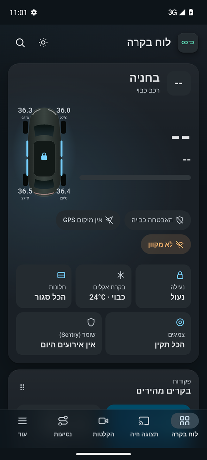
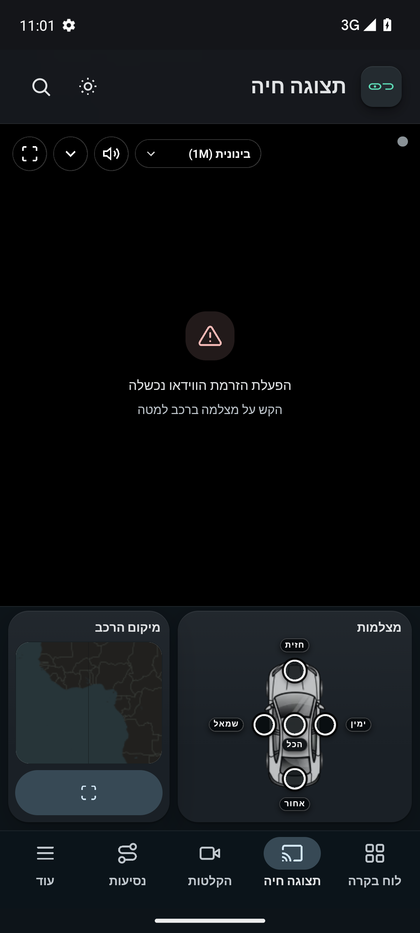
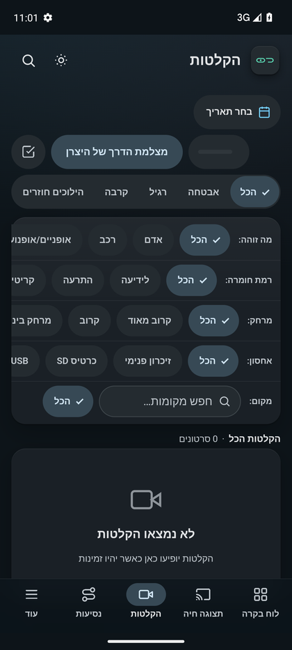
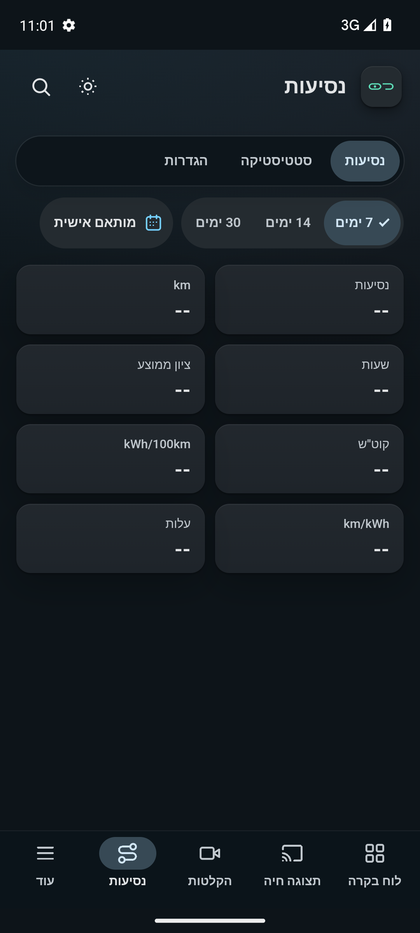
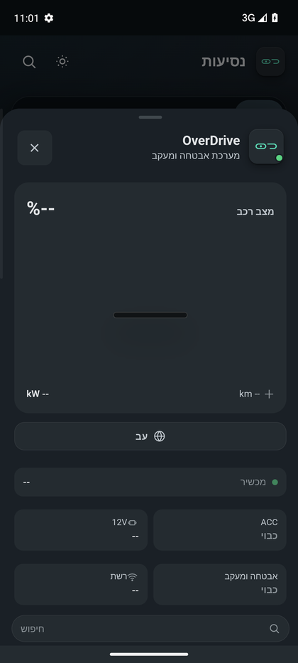
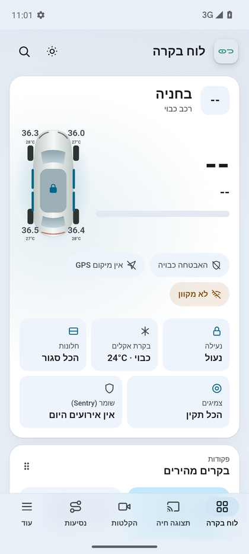
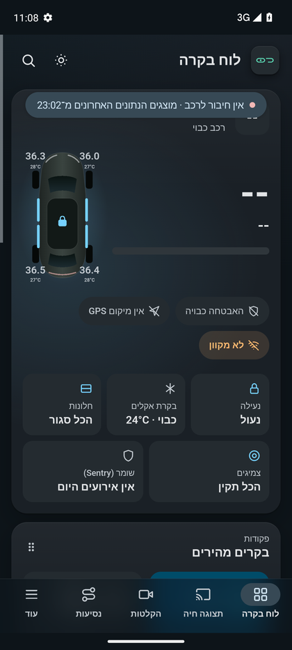

<div align="center">

# OverDrive Companion

The developer’s OverDrive web UI on your phone — native Android, not a browser tab.

[](https://github.com/HTTPS1121/overdrive-companion/releases/latest)
[](app/build.gradle.kts)
[](https://github.com/HTTPS1121/overdrive-companion/actions/workflows/release.yml)

[**Download latest APK**](https://github.com/HTTPS1121/overdrive-companion/releases/latest)

</div>

---

<div dir="rtl">

## מה זה?

**OverDrive Companion** היא אפליקציית Android שמציגה את **ממשק ה-Web של OverDrive** (לרכבי BYD) כאפליקציה מקומית — בלי תחושת דפדפן, עם מסך מלא וניווט נוח.

- **צבעים מהטלפון** — Material You: גווני הממשק נלקחים מערכת הצבעים של המכשיר (בהיר/כהה).
- **קבצים בטלפון** — הורדות וצילומי מסך נשמרים באחסון המכשיר, לא רק בתוך ה-WebView.
- **אותן גרסאות כמו ברכב** — מספר הגרסה של האפליקציה תואם לשחרור OverDrive שמוטמע בה (עם סיומת קטנה אם רק המעטפת השתנתה).

### התקנה

1. הורד את ה־APK מהקישור למעלה ([שחרורים](https://github.com/HTTPS1121/overdrive-companion/releases/latest)).
2. אשר התקנה ממקור לא ידוע אם Android מבקש.
3. פתח את האפליקציה.
4. הזן את **כתובת שרת הרכב** ואת **קוד ההתחברות** (כמו בממשק הרגיל).

### צילומי מסך

<small>הצילומים משרת בדיקות — הנתונים לדוגמה בלבד.</small>

<table>
  <tr>
    <td align="center"><b>לוח בקרה (כהה)</b><br/></td>
    <td align="center"><b>תצוגה חיה (כהה)</b><br/></td>
    <td align="center"><b>הקלטות (כהה)</b><br/></td>
  </tr>
  <tr>
    <td align="center"><b>נסיעות (כהה)</b><br/></td>
    <td align="center"><b>תפריט (כהה)</b><br/></td>
    <td align="center"><b>לוח בקרה (בהיר)</b><br/></td>
  </tr>
  <tr>
    <td align="center" colspan="3"><b>תג לא מקוון</b><br/></td>
  </tr>
</table>

### קרדיט

ממשק ה-Web ו־OverDrive שייכים למפתח ([Overdrive-release](https://github.com/yash-srivastava/Overdrive-release)).  
פרויקט זה הוא **מלווה לא רשמי** — מעטפת Android נפרדת שמארזת את ה-UI המפורסם.

</div>

---

## English

**OverDrive Companion** wraps the developer’s **OverDrive web UI** (for BYD vehicles) in a native Android app — full screen, app-like navigation, no “browser chrome” feel.

- **Material You** — accent and surface colors follow your phone’s light/dark theme.
- **Phone-native files** — downloads and screenshots go to device storage.
- **Car-aligned versions** — the app version matches the bundled OverDrive head-unit release (with an extra patch digit when only the shell changed).

### Install

1. Download the APK from [**Releases**](https://github.com/HTTPS1121/overdrive-companion/releases/latest).
2. Allow installs from unknown sources if Android prompts you.
3. Open the app.
4. Enter your **car server address** and **login code**.

### Screenshots

<small>Screenshots use a test server — sample data only.</small>

<table>
  <tr>
    <td align="center"><b>Dashboard (dark)</b><br/></td>
    <td align="center"><b>Live view (dark)</b><br/></td>
    <td align="center"><b>Recordings (dark)</b><br/></td>
  </tr>
  <tr>
    <td align="center"><b>Trips (dark)</b><br/></td>
    <td align="center"><b>Menu (dark)</b><br/></td>
    <td align="center"><b>Dashboard (light)</b><br/></td>
  </tr>
  <tr>
    <td align="center" colspan="3"><b>Offline pill</b><br/></td>
  </tr>
</table>

### Credit

The web UI and OverDrive are by the developer — see [Overdrive-release](https://github.com/yash-srivastava/Overdrive-release).  
This repo is an **unofficial companion**: an Android shell that bundles the published web UI.

---

## פיתוח · Development

<div dir="rtl">

<details>
<summary><strong>מבנה הריפו וגרסאות</strong></summary>

- קוד האפליקציה: `app/`. ניסוי Flutter ישן: `legacy/flutter/`.
- `app/src/main/assets/WEB_SOURCE.json` — גרסת השחרור מהרכב שמוטמעת כרגע.
- `app/shell_patch.txt` — מונה תיקוני מעטפת בלבד (`0` = אותו מספר כמו ברכב; `1` → `61.1.1`, …).
- `versionName` = שם השחרור, או `שם.patch` אם רק המעטפת השתנתה.
- `versionCode` = `upstreamVersionCode × 100 + patch`.

```bash
tools/print-version.sh
```

</details>

<details>
<summary><strong>עדכון ממשק Web מהמפתח</strong></summary>

```bash
tools/update-web-assets.sh
```

Workflow ידני בלבד ב־GitHub Actions: **Update bundled OverDrive web UI** (`workflow_dispatch`, ללא לוח זמנים).  
אם יש שחרור חדש — מעדכן נכסים, מאפס את `shell_patch.txt` ל־`0` ודוחף; אז **Release companion APK** מפרסם APK חתום.

שינוי מעטפת בלבד: הגדל `app/shell_patch.txt` ודחוף ל־`main` (רק שינויי `app/`/`tools/` מפעילים שחרור אוטומטי).

</details>

<details>
<summary><strong>בנייה מקומית</strong></summary>

JDK 17+, Android SDK.

```bash
./gradlew :app:assembleRelease
```

שחרורים רשמיים נבנים ב־CI (`release.yml`) — push ל־`main` רק כשמשתנים קבצי אפליקציה/כלים, לא לתיעוד בלבד.

</details>

</div>

<details>
<summary><strong>Repository layout &amp; versioning</strong></summary>

- Active app: `app/`. Archived Flutter experiment: `legacy/flutter/`.
- `WEB_SOURCE.json` — bundled OverDrive release metadata.
- `app/shell_patch.txt` — shell-only patch counter.
- `versionName` / `versionCode` derived in Gradle (`upstreamCode × 100 + patch`).

```bash
tools/print-version.sh
```

</details>

<details>
<summary><strong>Refresh bundled web UI</strong></summary>

```bash
tools/update-web-assets.sh
```

Run **Update bundled OverDrive web UI** manually when you want a newer APK from [Overdrive-release](https://github.com/yash-srivastava/Overdrive-release). Resets patch to `0` on upstream bumps.

Shell-only changes: increment `app/shell_patch.txt` and push.

</details>

<details>
<summary><strong>Local build &amp; CI</strong></summary>

```bash
./gradlew :app:assembleRelease
```

**Release companion APK** runs on `workflow_dispatch` and on pushes to `main` that touch `app/`, `tools/`, or Gradle files — not README/docs-only changes.

</details>